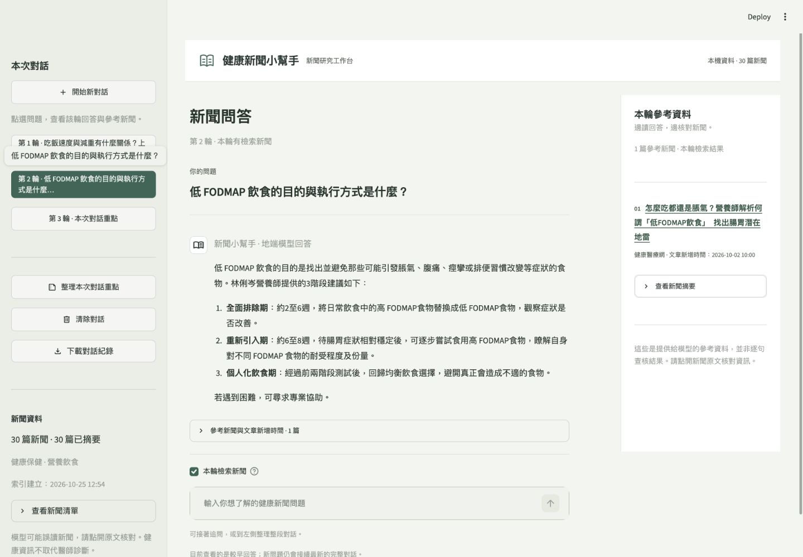

# 健康新聞 RAG 小幫手

作業三：爬取健康醫療網新聞分類，以地端模型摘要新聞，將摘要建立向量索引，再以網頁進行附來源的多輪問答。

- [課程與作業要求](https://github.com/telunyang/python_nlp/blob/master/README.md)
- [健康醫療網](https://www.healthnews.com.tw/)
- 地端生成：[mlx-community/Qwen2.5-3B-Instruct-4bit](https://huggingface.co/mlx-community/Qwen2.5-3B-Instruct-4bit)，未微調，不載入作業二笑話 adapter。
- 地端向量：[intfloat/multilingual-e5-small](https://huggingface.co/intfloat/multilingual-e5-small)，遮罩 mean pooling、L2 正規化、cosine similarity。

## 正式介面



目前收錄「健康保健」與「營養飲食」各15篇，依爬取當時分類頁順序取有效且不重複文章；不是隨機抽樣或醫療品質評選。聊天只檢索這30篇，不會即時搜尋全網。擴充資料需重新爬取、摘要並建立索引；相似文章仍可能不足以支持回答，不能把附來源視為事實查核完成。

## 安裝與執行

先將本 repository 複製到本機，或下載 ZIP 解壓縮；以下以資料夾名稱 `health-news-rag-assistant` 為例。

適用目前的 Apple Silicon Mac；Python 3.13，使用 uv。套件版本記錄於 `uv.lock`。

```bash
cd health-news-rag-assistant
uv sync --locked
uv run python 00_download_models.py
uv run python 01_crawl.py
uv run python 02_summarize.py
uv run python 03_build_index.py
uv run streamlit run app.py --server.port 8503
```

開啟 [本機網頁](http://127.0.0.1:8503)。兩個模型 revision 固定於 `model_sources.json`。模型第一次下載需要網路；摘要、embedding 與問答均於本機執行，不使用雲端推論 API。

`00_download_models.py` 如發現作業二已有相同原始模型，會在本資料夾的 `models/` 建立符號連結重用；不修改前兩份作業。獨立複製本專案時，會從 Hugging Face 下載模型。可用環境變數 `HW3_MODEL_PATH` 指定模型目錄。

## 新聞研究工作台（B 版介面）

2026-10-25 依使用者選定的 B 版預覽，正式採用三區結構：

- 左側：開始／清除對話、歷史問題、整段對話重點、下載與新聞資料。
- 中間：目前選取的問題與回答、該輪引用、檢索 checkbox 與真實模型輸入。
- 右側：目前回答的參考新聞、文章新增時間、摘要及相似度。切換問題會同步切換來源。

手機及較窄視窗（850px以下）將問答與參考資料上下排列。每輪回答後也保留可展開的引用，方便在手機核對。

查看舊回答只影響畫面；下一次送出問題仍會接續完整對話，不會從舊輪另開分支。介面比較原型另存 `design/ui-prototype` 分支，僅供設計參考；正式主分支只保留選定的 B 版實作。

樣式在 `assets/workbench.css`；`hw3/ui.py` 處理日期與來源的呈現；`app.py` 管理 Streamlit 操作及 session。新增部分保留繁體中文註解。

## 使用

1. 勾選「本輪檢索新聞」，詢問與收錄文章有關的第一題。
2. 再詢問一個不同問題；每輪下方會列出新聞標題、連結與文章新增時間。
3. 按「整理本次對話重點」，或輸入「請把剛才的問題整理成重點」。整理沿用前文來源，不新增檢索。
4. 取消 checkbox 可以在不新增檢索的情況下追問；第一輪無來源時會提示開啟檢索。
5. 「下載對話紀錄」保存本次 session；「清除對話」重設歷史。應用不自動寫入私人聊天原文。

## 資料庫

`data/news.sqlite3` 的 `articles` 資料表：

| 欄位 | 用途 |
|---|---|
| id | 流水號 |
| title | 新聞標題 |
| url | 新聞連結，唯一鍵 |
| content | 文章全文 |
| summary | 地端模型產生的摘要 |
| published_at | 網站文章新增／發布時間，回覆引用此欄 |
| crawled_at | 資料庫收錄時間 |
| category | 爬取分類 |
| content_hash | 偵測全文變更 |
| summary_meta / summarized_at | 摘要模型、revision、原始輸出、耗時與產生時間 |

預設各分類15篇，合計30篇不重複新聞；請求至少間隔1.5秒並先讀 robots.txt。原始 HTML 僅保存於本機，方便檢查解析與排錯。

```bash
uv run python 01_crawl.py --per-category 15 --categories 健康保健 營養飲食
```

相同網址與內容不新增；全文或標題更新會清除舊摘要。重跑摘要只處理缺少摘要的文章。若明確需要重新生成，使用 `02_summarize.py --redo`，程式會先備份現有摘要。改動資料後重新執行摘要與索引；過期索引會拒絕查詢。

## 模型與檢索設定

- 原始 MLX 4-bit 模型；temperature=0、seed=42，摘要每段最多380 tokens，長文整合最多420 tokens，回答最多650 tokens。
- 摘要將標題及全文合併進入提示；正文每1800 tokens 分段，所有段落均處理。
- 原始輸出保存在摘要 metadata 與展示紀錄；顯示文字經 OpenCC `s2twp` 轉換為繁體中文，不做人工改寫。
- E5 embedding 於 CPU 執行，每批8筆、最多512 tokens；摘要使用 `passage: `，問題使用 `query: `。
- NumPy 向量索引保存至 `data/index.npz`；索引設定、語料 SHA-256 與模型 revision 見 `data/index_manifest.json`。
- 檢索最多3篇，cosine 門檻0.83，且只保留與最高分相差不超過0.02的候選。這些值依開發問題及無關問題試查設定，未以獨立資料校準，不代表相關性或回答正確率保證。
- 短問題或含指代的追問會合併上一題。模型回答同時讀取摘要與每篇最多2000字的原文節錄，以原文為優先依據。最多提供最近6輪對話、9篇既有來源；超過模型輸入上限會提示清除對話。

## 示範與驗證

```bash
uv run python -m unittest discover -s tests -v
uv run python 04_demo.py
```

示範依序詢問吃飯速度與減重、低 FODMAP 飲食，再整理兩題，結果保存到各自的 `results/demo_時間/`，不覆寫前次紀錄。

- `conversation.json`：問題、原始回答、繁體回答、實際新聞來源、是否檢索。
- `environment.json`：實際環境、套件、模型與索引設定。
- `report.md`：可閱讀的三輪實際對話。
- `results/crawl_report.json`：本次爬取數量、來源與錯誤紀錄。

本次已完成30篇新聞、30篇地端摘要與384維索引；原有13項測試通過；B版介面加入來源隨選取切換的測試後，共14項通過。三輪正式示範約 34.68 秒，詳見 [實際對話](results/demo_2026-10-25T125614_0800/report.md) 與 [品質觀察](results/quality_review.md)。測試中的假模型只用於檢查操作邏輯，正式示範使用真實地端模型。

## 限制與發布

小型語言模型可能產生原文未支持的內容、錯字或摘要遺漏；附來源不能保證逐句正確。新聞本身也可能包含廣告、個案或未經獨立驗證的研究說法。這是健康新聞資訊整理作業，不提供個人診斷或自行調藥指示。

`data/`、`models/`、虛擬環境不納入 Git。新聞全文與原始 HTML 僅供本機作業處理，不應直接公開轉載；repository 保留程式、說明、必要的摘要／問答紀錄與畫面截圖；模型、新聞全文、虛擬環境與本機執行日誌由 `.gitignore` 排除。

已將 Streamlit 檔案監看設為 `none`，避免開發監看器掃描 Transformers 的選用影像模組而觸發無關套件匯入；修改程式後需重新啟動網頁。

流程與原理見 [LEARNING_GUIDE.md](LEARNING_GUIDE.md)，實作依據見 [DESIGN.md](DESIGN.md)。
